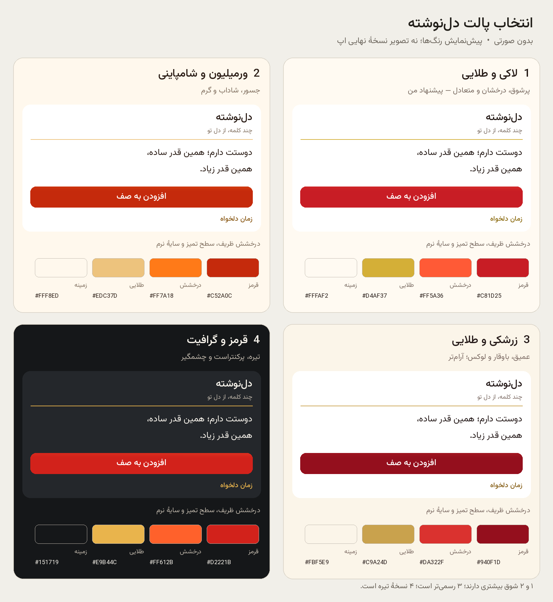

# گزینه‌های رنگ نسخهٔ بعد

انتخاب پالت در انتظار پاسخ مالک است. این‌ها پیش‌نمایش رنگ‌اند و تصویر APK نهایی نیستند. رنگ تولیدی هنوز عوض نشده است. صورتی در هیچ گزینه‌ای وجود ندارد. توصیه: گزینهٔ ۱ برای ترکیب شوق و کیفیت؛ گزینهٔ ۲ برای هیجان بیشتر؛ گزینهٔ ۳ برای حال‌وهوای آرام‌تر و لوکس؛ گزینهٔ ۴ برای نسخهٔ تیره.

| گزینه | هویت | قرمز | درخشش | طلایی | زمینه |
| --- | --- | --- | --- | --- | --- |
| ۱ | لاکی و طلایی | #C81D25 | #FF5A36 | #D4AF37 | #FFFAF2 |
| ۲ | ورمیلیون و شامپاینی | #C52A0C | #FF7A18 | #EDC37D | #FFF8ED |
| ۳ | زرشکی و طلایی | #940F1D | #DA322F | #C9A24D | #FBF5E9 |
| ۴ | قرمز و گرافیت | #D2221B | #FF612B | #E9B44C | #151719 |

طلاییِ روشن برای جزئیات تزئینی است؛ برای متن و کنترل فعال روی سطح روشن، از طیف تیره‌تر `gold_ink` در palettes.json استفاده می‌شود تا خوانایی حفظ شود. برق و حس عمق از درخشش محدود لبه‌ها، گرادیان اشباع و سایهٔ نرم می‌آید؛ متن روی بخش اصلیِ قرمز باقی می‌ماند.

بازسازی تصویر: `python3 docs/design-options/render_palettes.py` با Pillow و libraqm، با استفاده از وزیرمتن بسته‌بندی‌شدهٔ پروژه.
